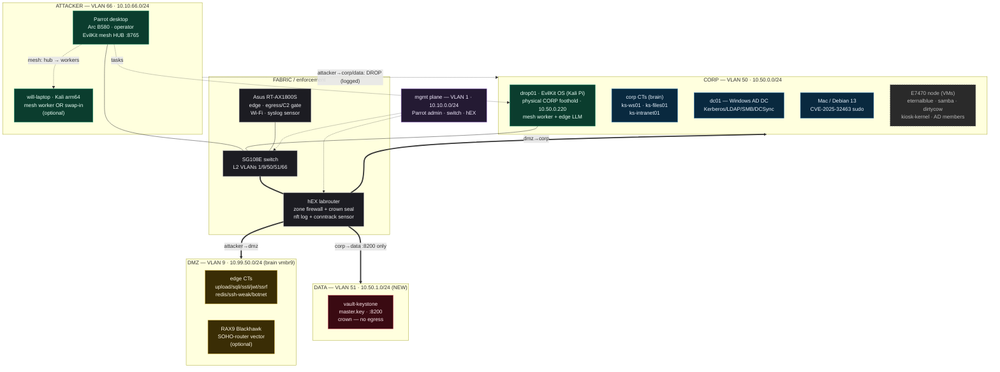

# Keystone full-gear topology

Companion to `HOMELAB_FULL_GEAR_REDESIGN.md`. Zones are real VLANs through the
SG108E, enforced by the hEX. Solid arrows = allowed flows (directed policy);
dotted = out-of-band mgmt. Everything not drawn is DROP.

## Reading the map

- **Attacker** reaches only the **DMZ**. `attacker→corp` and `attacker→data` are
  dropped and logged on the hEX — the agent must pivot.
- **DMZ→corp** is allowed only to the published corp hosts; **corp→data** is
  allowed only to the vault on **:8200**; **data initiates nothing outbound**.
- The crown is reachable solely by the full pivot
  `attacker → dmz → corp → data`, now across a real VLAN boundary.
- Grey dashed = blocked-on-parts (E7470 needs a SODIMM); optional nodes labelled.
- **One control plane:** the dotted mesh edges show the EvilKit **hub** on Parrot
  leading its **worker** nodes (the EvilKit OS Pi today, will-laptop optionally).
  Adding attacker gear = adding workers under one hub, not operating two PCs —
  each worker streams into its own window on the hub. See `§5` of the redesign.
- The EvilKit OS Pi's control role is out-of-band; its physical `eth0` sits in
  CORP and is denied direct DATA access, so the planted-hardware path must still
  lateral through an approved CORP host before reaching the crown.
